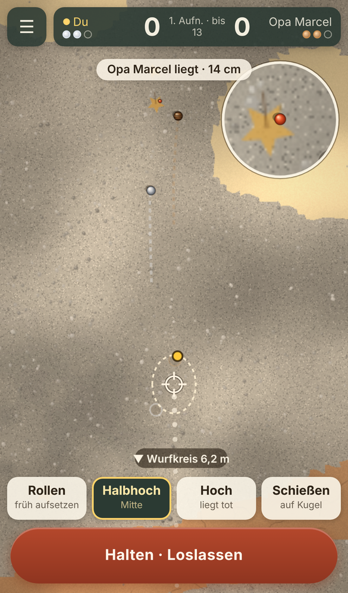
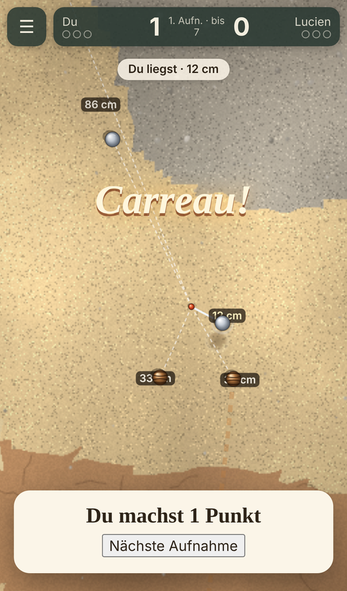
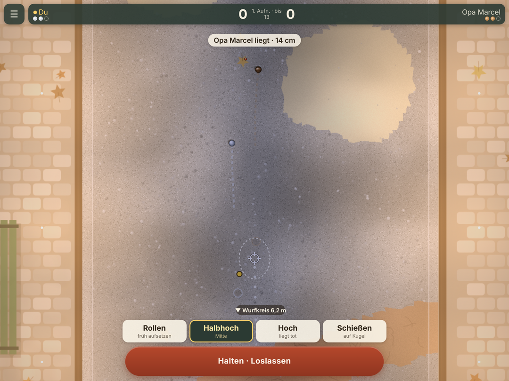

# Carreau – Boule unter Platanen

Ein Nachmittag auf dem Dorfplatz von Saint-Aurel: Kies, Zikaden, das Klacken von Stahl auf Stahl.
Du spielst Boule (Pétanque) Mann gegen Mann gegen die Leute aus dem Dorf – jeder mit eigener Art
zu spielen –, auf Plätzen, die jedes Mal anders sind und sich mit jedem Wurf ein bisschen verändern.
Jeder Wurf ist eine Entscheidung (legen oder schießen? rollen oder hoch? wohin?) und eine
Ausführung mit der eigenen Hand. Kein versteckter Würfel entscheidet für dich.

- **Künftige Adresse** (live, sobald Mirko das Spiel nach `main` übertragen hat):
  **`https://babypython67.github.io/Projects/carreau/`**
- **Lokal starten:** `cd carreau && npm start`, dann <http://localhost:8080/> öffnen.
  Ohne Node geht auch `cd carreau && python3 -m http.server 8080`.
- Statische Seite, kein Build, kein Konto, keine API-Keys, keine externen Server oder Schriften.



## Kurzanleitung

1. **Dorfpartie** wählen und einen Gegner herausfordern (am Anfang Lucien oder Opa Marcel).
2. **Zielen:** mit dem Finger irgendwo auf dem Platz ziehen – die Zielmarke wandert mit (Tippen setzt sie direkt).
   Die Marke ist der **Aufsetzpunkt**; wie weit die Kugel danach rollt, musst du am Boden ablesen.
3. **Wurfart:** Rollen, Halbhoch, Hoch oder Schießen (beim Schießen auf eine Kugel tippen, die Marke rastet ein).
4. **Werfen:** den runden Knopf **halten**. Der gelbe Punkt pendelt in der Ellipse und zeigt genau, wo die Kugel
   landen würde. **Loslassen**, wenn er gut steht. Wer zu lange hält, zittert. Finger weit wegziehen bricht ab.
5. Wer **nicht** den Punkt hält, wirft. Am Ende der Aufnahme zählt jede eigene Kugel, die näher an der Sau liegt
   als die beste gegnerische. Wer zuerst 13 (oder 7) hat, gewinnt.

Weitere Modi: **Tagesplatz** (jeden Tag ein neuer Platz und Gegner für alle, bis 7, Ergebnis zum Teilen),
**Zu zweit an einem Gerät** (Silber gegen Bronze, Gerät weiterreichen), **Übungsplatz** (unbegrenzt werfen,
Abstand wird angezeigt). Antippen während die Kugeln rollen spult vor. Die ausführliche Anleitung steht im Spiel.

## Fortschritt auf dem iPad – auch nach Wochen Pause

- **Gespeichert wird nach jedem Wurf** (und beim Schließen/Wegwechseln) im `localStorage`, doppelt
  (Haupt- und Sicherungseintrag). Wird der Tab mitten im Wurf geschlossen, ist der Wurf schon vorher
  gesichert und wird beim nächsten Öffnen deterministisch zu Ende gerechnet – man kann ihn also weder
  verlieren noch durch Neuladen wiederholen. Der Smoke-Test prüft genau das.
- **Safari-Problem:** Safari löscht den Speicher von Webseiten, die man 7 Tage (Safari-Nutzungstage) nicht
  besucht hat. **Lösung: Carreau zum Home-Bildschirm hinzufügen** (Teilen-Symbol → „Zum Home-Bildschirm“).
  Als Home-Bildschirm-App gilt diese Löschregel nicht, Carreau startet dann im Vollbild und läuft dank
  Service Worker auch ohne Netz. Der Titelbildschirm erinnert auf iPhone/iPad daran.
- **Zweiter Weg, unabhängig vom Browser:** „Sichern“ → **Sicherungscode kopieren** (ein Text, z. B. in die
  Notizen-App). Auf jedem Gerät lässt er sich unter „Sichern“ wieder einspielen – auch nach einem Gerätewechsel.
- Zusätzlich bittet das Spiel den Browser per `navigator.storage.persist()` um dauerhaften Speicher.

## Recherche

**Wichtig vorab:** Die Websuche funktionierte, das *Öffnen* fremder Seiten nicht – das Netzwerk dieser
Cloud-Umgebung sperrt alle Hosts außer Paketquellen (Fehler `getaddrinfo ENOTFOUND` für
lostgarden.com, skeletoncodemachine.com, indieorama.com, newsblog.drexel.edu, meeplemountain.com).
Ich konnte deshalb **keine Quelle selbst öffnen**; was unten steht, stützt sich auf die Auszüge, die
die Suche zu jeder Seite geliefert hat, plus mein Vorwissen. Jede Quelle ist entsprechend markiert.

| # | Quelle | Art | Was ich übernommen habe | Geöffnet? |
|---|--------|-----|-------------------------|-----------|
| 1 | Daniel Cook: [„Loops and Arcs“](https://lostgarden.com/2012/04/30/loops-and-arcs), Lostgarden (2012) | Designer-Blog (außerhalb der Klassiker) | Dauerhafter Reiz kommt aus *Schleifen*, die das mentale Modell des Spielers immer wieder aktualisieren; *Bögen* (Story, Freischaltungen) werden verbraucht. Darum trägt Carreau die Wurf-Schleife mit sichtbarem Feedback (Rollspur bleibt im Kies) und nicht Inhalte. | Nein – Host gesperrt, nur Suchauszug |
| 2 | Skeleton Code Machine: [„Input-Output Randomness (Part 1)“](https://www.skeletoncodemachine.com/p/input-output-randomness-part-1) (nach Geoff Engelstein) | Brettspiel-Design (außerhalb) | Zufall *vor* der Entscheidung fordert Können, Zufall *nach* der Entscheidung macht gute Züge kaputt. Darum werden Platz und Gegner vorher ausgewürfelt; der Wurf selbst hat keinen versteckten Würfel – die Streuung kommt nur aus deinem Timing. | Nein – Host gesperrt, nur Suchauszug |
| 3 | Rich Vreeland (Disasterpeace) im Interview: [„The Programmed Music of Mini Metro“](https://designingsound.org/2016/02/18/the-programmed-music-of-mini-metro-interview-with-rich-vreeland-disasterpeace), Designing Sound | Interview (außerhalb) | Kaum Trennung zwischen Klangdesign und Musik, Klang aus Spielereignissen statt aus Loops. Jeder Klang in Carreau wird live aus Aufprallgeschwindigkeit, Material und Boden synthetisiert – nichts ist aufgenommen. | Nein – nur Suchauszug |
| 4 | [„How the World's Greatest Game Designer Designs Games“](https://mentalfloss.com/article/26896/how-worlds-greatest-game-designer-designs-games) (Reiner Knizia, Mental Floss) und [Meeple Mountain interviews Dr. Reiner Knizia](https://www.meeplemountain.com/interviews/meeple-mountain-interviews-dr-reiner-knizia/) | Brettspiel-Interviews (außerhalb) | Testen und Verfeinern sind laut Knizia das „Lebenselixier“ des Designs, aber „Spieldesign ist keine Wissenschaft, sondern Kunst“. Daraus: Hunderte Bot-Partien als unermüdliche Testspieler – und trotzdem Feinschliff nach Gefühl, wenn die Zahlen stimmen, das Spiel sich aber falsch anfühlt. | Nein – Host gesperrt, nur Suchauszug |
| 5 | Kritiken zu *Desert Golfing*: [The Tiny Narrative](https://thetinynarrative.substack.com/p/desert-golfing), [Vice/Creators](https://creators.vice.com/en/article/wnjg4b/why-hardcore-gamers-are-hooked-on-a-2d-desert-golf-game) | Spielkritik (außerhalb) | Eine einzige Geste plus endlos neue, prozedurale Bahnen trägt über Monate; das Spiel lässt sich jederzeit aufnehmen und weglegen und „ist noch da, wenn man zurückkommt“. Daraus: prozedurale Plätze, kurze Aufnahmen, Speichern nach jedem Wurf. | Nein – nur Suchauszug |
| 6 | Elias, Garfield, Gutschera: [*Characteristics of Games*](https://mitpressbookstore.mit.edu/book/9780262542692) (MIT Press) und Garfield zu Glück, zitiert bei [Tom Sloper](https://sloperama.com/mahjongg/column2/column808.html) | Buch und Kolumne von Karten-/Brettspiel-Designern (außerhalb) | Glück und Können sind zwei getrennte Achsen; ein wenig Glück wirkt als „sozialer Ausgleich“, damit Schwächere dranbleiben. Daraus: Glück gibt es nur als kleine, *sichtbare* Unebenheit (Grobkies) und den Münzwurf am Anfang – gemessen wird, dass Können klar dominiert (siehe „Messung“). | Nein – nur Suchauszug |
| 7 | [„Q+A: The Legacy of Tetris“](https://newsblog.drexel.edu/2023/04/05/qa-the-legacy-of-tetris/), Drexel University | Wissenschaftliche Spielkritik (außerhalb) | Tetris als fast perfektes „leicht zu lernen, schwer zu meistern“: jede Partie ist ein neues Spiel, die Schwierigkeit verschwindet nie. Daraus: keine auswendig lernbaren Level – jeder Platz und jede Lage um die Sau ist neu. | Nein – Host gesperrt, nur Suchauszug |
| 8 | Obut: [„How to shoot your pétanque boule properly“](https://obut.com/en/blog/petanque/how-to-shoot-your-petanque-boule-properly), ActiveSG: [„Common petanque strategies“](https://www.activesgcircle.gov.sg/learn/petanque/common-petanque-strategies) | Fachwissen Pétanque | Wer nicht den Punkt hat, wählt zwischen Legen und Schießen; der beste Punkt ist manchmal nicht der nächste, sondern einer, der blockiert. Das steckt in der Bewertungsfunktion der Dorf-KI und in den Tipps. | Nein – nur Suchauszug |
| 9 | GDC Board Game Design Day: [„White, Brown, and Pink: The Flavors of Tabletop Game Randomness“](https://gdcvault.com/play/1024920/Board-Game-Design-Day-White) und Game Developer zu [„Mini Metro: When Less Is More“](https://www.gamedeveloper.com/design/attend-gdc-2017-and-learn-the-value-of-less-is-more-from-a-i-mini-metro-i-dev) | Klassiker (GDC / Game Developer) | Bestätigung von 2 (Zufall muss Form haben) und: in einem reduzierten Spiel *ist* Grafikdesign Spieldesign. Daraus: wenige, klar lesbare Elemente (Kugeln, Sau, Schattierung des Bodens) statt Effektgewitter. | Nein – nur Suchauszug |

Quellen 1–8 liegen außerhalb der üblichen Klassiker (Designer-Blog, Brettspiel-Design, Interviews,
Spielkritik, Fachliteratur); nur 9 gehört dazu.

---

## Wie die Idee entstand

### Anker

Zwei breit gestreute Listen, dann je ein Eintrag per Zufallszahl:

| Nr. | Kernverb | Schauplatz |
|----:|----------|------------|
| 1 | werfen | Dorfplatz in der Provence |
| 2 | lenken | Raumstation im Orbit |
| 3 | stapeln | Glockenturm einer Stadtkirche |
| 4 | tauschen | Karawanserei in der Wüste |
| 5 | verbinden | Steilwand im Hochgebirge |
| 6 | schneiden | Uhrmacherwerkstatt |
| 7 | balancieren | zugefrorener Alpensee |
| 8 | lauschen | Nachtmarkt in Taipeh |
| 9 | wachsen lassen | Tiefsee-Forschungsstation |
| 10 | verhandeln | barocke Klosterbibliothek |
| 11 | umleiten | Waldboden / Pilzgeflecht |
| 12 | falten | Teehaus in Kyoto |
| 13 | jonglieren | Vulkaninsel |
| 14 | verstecken | Fahrradwerkstatt im Hinterhof |
| 15 | klettern | U-Bahn-Netz einer Großstadt |
| 16 | takten | Zirkuszelt |

Befehl und Ergebnis (Zahlen von 1 bis 16, kryptografischer Zufall):

```
$ node -e "const c=require('crypto');const v=c.randomInt(1,17), o=c.randomInt(1,17);console.log('Verb-Nr.', v, '| Schauplatz-Nr.', o)"
Verb-Nr. 11 | Schauplatz-Nr. 12
```

**Anker: „umleiten“ × „Teehaus in Kyoto“.**

### Sieben Ideen

1. **Kakehi** *(direkt aus dem Anker)* – Echtzeit-Fluss-Puzzle in einem Kyotoer Teegarten: Du drehst
   Bambusrinnen und leitest Wasser so um, dass Shishi-odoshi (Bambus-Wippen) im Takt kippen; der Garten
   wird zum Rhythmusinstrument. Ruhig, meditativ, Holz und Wasser.
2. **Chaji** *(auch aus dem Anker)* – Du bist Teemeister und leitest das *Gespräch* einer Teezeremonie
   um: Gäste mit verborgenen Stimmungen, Themenkarten, Harmonie halten, ohne dass jemand das Gesicht
   verliert. Leises soziales Taktikspiel.
3. **Carreau** – Boule (Pétanque) auf prozeduralen Dorfplätzen in der Provence, nachmittags unter
   Platanen. Physik-Wurf mit eigener Hand, echte Taktik (legen oder schießen, Kugeln in Reserve, die Sau
   verschieben), Dorfbewohner als Gegner mit eigenem Stil. Warm, sonnig, gesellig.
4. **Wechselläuten** – Glockenturm einer Stadtkirche am Sonntagmorgen: Du lenkst die Reihenfolge von
   sechs Glocken (englisches Change Ringing). Jede Reihe darf nur einmal erklingen, musikalische Reihen
   bringen Punkte, am Ende musst du zurück in die Ausgangsreihe finden. Ein Permutations-Puzzle, das klingt.
5. **Umlauf** – Ein kleiner Schlepper an einer Raumstation im Orbit. Mit wenigen Schubimpulsen
   Schrott einsammeln und Fracht zustellen; echte Bahnmechanik (gegen die Fahrtrichtung bremsen, um
   schneller zu werden). Kühl, still, weit.
6. **Myzel** – Abstraktes Territorialspiel auf dem Waldboden: zwei Pilzgeflechte wachsen um Nährstoffe,
   Go-artige Tiefe, organische Grafik.
7. **Seilschaft** – Rundenbasierte Kletterroute in einer Granitwand: Griffe wählen, Sicherungen setzen
   (kosten Zeit, retten beim Sturz), Wetter zieht auf. Push-your-luck in der Senkrechten.

### Gestrichen: die naheliegendste

**Kakehi.** Sie ist die wörtlichste Übersetzung des Ankers und landet sofort in einer Genre-Schablone:
Wasser durch Rohre umleiten ist *Pipe Mania* mit Bambus, und „Zen-Garten mit Wasserklang“ ist eines der
häufigsten Bilder im Mobile-Puzzle-Regal. Dazu kommt: Wasser lenken war schon der Kern des
Sturmflut-Spiels am Deich – genau die Wiederholung, die vermieden werden soll.

### Die Wahl: Carreau

Gemessen an den vier Ansprüchen:

- **Über Wochen fesselnd:** Boule ist ein Spiel, das Menschen ihr Leben lang jeden Nachmittag spielen –
  ohne Freischaltungen. Der Reiz steckt im System: Physik + Taktik + immer neue Plätze + Gegner mit Stil.
  *Desert Golfing* zeigt, dass eine Geste auf endlos neuen Bahnen Monate trägt; Carreau hat dazu noch
  einen Gegner, der zurückschlägt.
- **Tiefe zum Meistern:** Drei Schichten Können – Hand (Timing des Wurfs), Auge (Boden lesen: Gefälle,
  Sand, Grobkies, Wurzeln, Krater früherer Würfe) und Kopf (Taktik: legen oder schießen, wann eine
  Kugel in Reserve halten, die Sau ins Aus schießen). Zufall gibt es fast nur *vor* der Entscheidung.
- **Andere würden es spielen:** Die Regeln kennt jeder in fünf Minuten, das Klacken eines Carreaus
  versteht man ohne Erklärung, und zu zweit an einem iPad ist es ein echtes Partyspiel. Ein Boule-Spiel
  mit dieser Mischung aus Physik und Taktik gibt es im Browser praktisch nicht.
- **Ausbaufähig:** Doublette/Triplette mit Mitspielern, Turniere, Online-Duelle mit gleichem Platz-Seed,
  Karriere durch Dörfer und Plätze, weitere Wurfarten (Effet) – alles setzt auf denselben Physik- und
  Regelkern.

Warum nicht die anderen: *Wechselläuten* ist die eigenwilligste Idee und hat mich gereizt, aber
die Einstiegshürde (Permutationen im Kopf) ist so hoch, dass kaum jemand es Freunden schicken würde.
*Umlauf* hat Tiefe, droht aber zur Lieferroutine zu werden, und präzise Bahnplanung per Finger auf dem
Handy ist zäh. *Myzel* steht und fällt mit einer starken KI für ein Go-artiges Spiel – riskant in einer
ersten Version. *Chaji* und *Seilschaft* haben zu wenig messbares Können (Gesprächsstimmungen bzw. viel
Zufall beim Wetter).

Carreau unterscheidet sich klar von den früheren Spielen: Kernmechanik ist ein Physik-Wurf mit
Taktik gegen einen Gegner (kein Roguelite, kein Fangen, keine Simulation, keine Runden-Strategie gegen
die Natur), Schauplatz ist ein sonniger südfranzösischer Dorfplatz (nicht nachts, nicht Küste, nicht
Norddeutschland), Stimmung ist warm, gesellig und ein bisschen kompetitiv.

---

## Was das Spiel reizvoll macht

### 1. Über Wochen fesselnd
- **Jede Lage ist neu, ohne dass Inhalte verbraucht werden.** Prozedurale Plätze aus Gefälle, Mulden,
  Buckeln, Sandflecken, festgetretenem Lehmpfad, Grobkies und Platanenwurzeln (gemessen: über hundert
  verschiedene Kombinationen, siehe „Messung“). Der Wurfkreis wandert dorthin, wo die Sau zuletzt lag, und
  gespielt wird in die Richtung mit mehr Platz – jede Aufnahme spielt auf einem anderen Teil des Platzes.
- **Der Platz erinnert sich.** Hohe Würfe schlagen Krater, die bis zum Ende der Partie bleiben und spätere
  Kugeln einfangen; die Rollspur der letzten Würfe bleibt im Kies sichtbar. Ein Platz nach zehn Aufnahmen ist
  ein anderer als am Anfang – und eine Partie erzählt ihre eigene Geschichte.
- **Gegner mit Stil statt Schwierigkeitsregler.** Die Leute aus dem Dorf unterscheiden sich in Hand (Streuung
  je Wurfart) und Kopf (welche Würfe sie kennen, wie gern sie schießen, wie weit sie die Sau legen). Wer gegen
  einen Leger gewinnt, verliert damit noch lange nicht gegen eine Schützin – man muss jeden anders bespielen.
- **Tagesplatz:** jeden Tag ein neuer Platz und ein Gegner, für alle gleich – ein kurzer täglicher Anlass und
  ein Ergebnis zum Vergleichen.
- **Dorfwertung (Elo):** eine Zahl, die nur durch Siege gegen Stärkere steigt und auch wieder fällt – kein
  Abarbeiten, sondern ein ehrlicher Spiegel des Könnens.
- **Kunststücke aus dem System, nicht aus Text:** Carreau, Bise, Doppelschlag, Sau ins Aus … entstehen nur aus
  dem Spiel selbst; manche passieren einmal in hundert Partien (gemessen).
- **Stimmung nach der echten Uhrzeit:** Morgenlicht, heller Mittag, goldener Nachmittag, Abendrot, nachts eine
  Lichterkette über dem Platz und Grillen statt Zikaden.
- **Kurze Häppchen:** Eine Aufnahme dauert ein, zwei Minuten, gespeichert wird nach jedem Wurf.

### 2. Tiefe zum Meistern
Drei Schichten Können, die man getrennt verbessern kann:
- **Hand (Timing).** Der Landepunkt pendelt auf einer Lissajous-Bahn: quer und längs mit verschiedenen
  Frequenzen. Wer den ersten guten Moment nimmt, streut; wer wartet, bis der Punkt durch die Mitte geht,
  trifft – riskiert aber, dass die Hand nach gut zwei Sekunden zu zittern beginnt. Beim Matchball pendelt
  es schneller (Druck). Für Schüsse zählt quer, fürs Legen eher längs – man lernt, worauf man wartet.
- **Auge (Boden lesen).** Die Marke ist der Aufsetzpunkt, nicht das Ziel. Wo die Kugel liegen bleibt, hängt
  von Wurfart, Bodenart, Gefälle, Wurzeln und Kratern ab. Lesbar wird das über die Relief-Schattierung, die
  Farben der Böden, die Rollspur des letzten Wurfs und die Lupe. Gemessen: derselbe Wurf endet je nach Platz
  um rund einen halben Meter verschieden (siehe „Messung“).
- **Kopf (Taktik).** Wer nicht hält, muss werfen – Kugeln in der Hand sind die eigentliche Währung. Legen oder
  schießen? Eine Kugel vorlegen, um den Punkt zu schützen? Die Sau mit der eigenen Kugel verschieben? Die Sau
  ins Aus schießen, wenn nur noch man selbst Kugeln hat, damit jede zählt? Wie weit lege ich die Sau gegen
  jemanden, der kurz besser schießt?
- **Kein Output-Zufall beim Wurf:** Was der gelbe Punkt zeigt, ist exakt der Landepunkt. Zufall gibt es nur
  vorher und sichtbar (Platz, wer anfängt) und als kleine Mikro-Unebenheit im Kies, die auf grobem Kies
  stärker ist – und die man mit hohen Würfen umgehen kann.

### 3. Andere würden es spielen
- Boule kennt fast jeder aus dem Urlaub; die Regeln sind in einer Minute erklärt, der Rest ist Gefühl.
- **Zu zweit an einem Gerät:** Das iPad liegt auf dem Tisch, man reicht es weiter – ein echtes Spiel für zwei.
- **Tagesplatz mit teilbarem Ergebnis** (eine Zeile mit Punkten pro Aufnahme), wie man es von Wordle kennt.
- Läuft ohne Installation, ohne Konto, offline als Home-Bildschirm-App.
- Eigenständig: kein Klon. Es gibt Boule-Spiele, aber kaum eines mit echter Physik, lesbarem Boden, Gegnern
  mit Stil und Klang, der aus der Physik entsteht.

### 4. Ausbaufähig
- **Deterministischer Kern ohne Grafik** (`physics.js`, `terrain.js`, `rules.js`, `ai.js`): läuft identisch
  im Browser, in den Tests und in den Bot-Partien. Online-Duelle bräuchten nur die Saat und pro Wurf zwei
  Zahlen (Wurfart, Landepunkt) – die Physik rechnet auf beiden Geräten dasselbe.
- **Doublette/Triplette** (2–3 je Team, Rollen „Leger“ und „Schütze“): Regeln und Zustand sind schon nach Teams
  aufgebaut, die Kugelzahl ist eine Konstante.
- **Karriere** über mehrere Dörfer mit eigenen Platztypen (Strandsand, Boulodrome, Bergdorf mit Gefälle),
  Turniere im Poule-System, Wetter (nasser Boden bremst), Effet und „tir devant“ als weitere Wurftechniken.
- **Gegner sind Daten** (Streuung, Wurfarten, Schusslust, Saulänge) – neue Figuren brauchen keinen neuen Code.

## Handschrift

Ich habe dieses Spiel gebaut, weil mich an Boule etwas fasziniert, das Videospiele selten schaffen: **ein
einziger Wurf ist gleichzeitig Kopf, Auge und Hand.** Man steht im Kreis, schaut auf den Kies, überlegt, ob man
legt oder schießt – und dann muss es die eigene Hand auch noch hinbekommen. Dafür brenne ich, und alles in
Carreau dient diesem Moment:

- **Der Klang ist die Physik.** Kein einziger Ton ist aufgenommen. Das Klacken entsteht aus der Aufprall-
  geschwindigkeit zweier Stahlkugeln (unharmonische Teiltöne, ein kurzer Klick, ein bisschen Hall von den
  Hausfassaden), das Knirschen aus der Bodenart unter der Kugel, das Holz der Sau klingt nach Holz. Jede
  Berührung antwortet: Ziehen knistert im Kies, Halten summt leise, Loslassen rauscht. Über allem Zikaden, die
  an- und abschwellen, Spatzen, Wind in den Platanen, abends Grillen, und zu jeder Aufnahme eine ferne Glocke.
- **Ehrlichkeit des Wurfs.** Ich wollte keinen versteckten Würfel. Der gelbe Punkt zeigt genau, wo die Kugel
  landet. Wenn sie danebengeht, war es mein Timing oder mein Blick auf den Boden – nie das Spiel.
- **Ein Platz, der sich erinnert.** Krater, Spuren, der wandernde Kreis: Am Ende einer Partie sieht man ihr an,
  was passiert ist. Das ist für mich der Unterschied zwischen einem Level und einem Ort.
- **Menschen statt Stufen.** Lucien, der alles halbhoch wirft. Opa Marcel, der seine Kugeln mit Engelsgeduld
  anrollt und die Sau gern weit legt, weil er weiß, dass junge Leute auf zehn Meter schlechter schießen.
  Die Figuren haben keine Dialogbäume – ihr Charakter *ist* ihre Spielweise.
- **Die Uhrzeit ist echt.** Wer abends spielt, spielt unter der Lichterkette. Ein kleines Detail, aber genau
  so fühlt sich ein Dorfplatz an.

## Entscheidungen (kurz)

- **Tête-à-tête** (1 gegen 1, je 3 Kugeln) statt Doublette: kürzere Partien, klare Verantwortung für jeden Wurf.
- **Draufsicht mit Schrägprojektion** statt 3D: auf dem Handy lesbar, Flughöhe sichtbar über Kugelgröße und
  Schattenabstand, kein WebGL nötig. Eine **Lupe** zeigt die Lage an der Sau, wenn die Kamera weit weg ist.
- **Zielmarke = Aufsetzpunkt**, nicht Endpunkt – Boden lesen ist Teil des Spiels, nicht Aufgabe einer Vorschau.
- **Halten und Loslassen eines Knopfs** statt Wischgeste: am Handy viel weniger Fehlwürfe; Zielen und Werfen
  sind getrennt, man kann in Ruhe zielen.
- **Pendel statt Kraftbalken:** zwei Achsen mit unterschiedlichen Frequenzen machen Timing zur Fertigkeit mit
  hoher Decke, ohne dass Glück mitspielt.
- **Regeln** nach Pétanque, mit zwei dokumentierten Vereinfachungen: Liegt keine Kugel mehr (alles weggeschossen),
  wirft, wer zuletzt geworfen hat. Wer die Sau zweimal ungültig wirft, dem legt sie der Gegner von Hand.
- **Gegner-Leiter:** Es sind immer mindestens zwei Gegner offen; ein Sieg gegen jemanden öffnet zwei Plätze
  weiter. Aufgeben zählt als Niederlage.
- **Keine Musik**, nur der Platz selbst. **Alle Grafik prozedural** auf Canvas, keine Bilddateien außer Icons.
- **Speichern** in `localStorage` (doppelt) plus Sicherungscode; Service Worker für den Offline-Start.

## Technik

```
carreau/
  index.html, style.css, manifest.webmanifest, sw.js, icons/
  src/rng.js       Saat-Zufall, Rauschen
  src/terrain.js   Platz: Relief, Bodenarten, Merkmale, Krater
  src/physics.js   Flug, Aufprall, Rollen, Stöße, Bande (deterministisch, ohne DOM)
  src/rules.js     Pétanque-Regeln für Tête-à-tête
  src/ai.js        Dorfbewohner, Landepunkt-Löser, Monte-Carlo-Bewertung
  src/headless.js  Partien ohne Grafik (Tests, Bots)
  src/render.js    Canvas-Grafik, Kamera, Lupe, Licht
  src/audio.js     Klangsynthese (Web Audio)
  src/game.js      Ablauf einer Partie, Touch-Eingabe, Pendel
  src/career.js, src/storage.js, src/main.js
  test/logic.test.mjs  Logik-Tests (node:test)
  test/smoke.cjs       Browser-Smoke-Test (Playwright, Handy-Viewport, Touch)
  tools/sim.mjs        Bot-Messung -> docs/messung.md
  tools/screens.cjs    Bildschirmfotos Handy/iPad -> docs/
```

Befehle (im Ordner `carreau`): `npm test` (Logik), `npm run smoke` (Browser), `npm run sim` (Messung,
~15 min), `npm run screens` (Fotos), `npm start` (lokaler Server). Für Smoke-Test und Fotos braucht man
Playwright mit Chromium (`npm install` und `npx playwright install chromium`); `node_modules` ist nicht im Repo.

Die Physik rechnet in Metern und Sekunden mit adaptivem Zeitschritt (höchstens 6 mm Weg pro Schritt, damit
nichts durch die 3-cm-Sau tunnelt): ballistischer Flug, Aufprall mit bodenabhängigem Rücksprung und
Coulomb-Reibung (hohe Würfe „sterben“), Rollen einer Vollkugel mit Rollwiderstand und Hangabtrieb, 3D-Stöße
Kugel gegen Kugel (Stahl e = 0,8; Holz-Sau e = 0,55). Ein Kopf-an-Kopf-Treffer überträgt fast den ganzen
Impuls – so entsteht der Carreau von selbst, ohne Sonderregel.

Die KI löst für jedes Ziel (an die Sau, dahinter, daneben, vorlegen, Sau schieben, Kugel oder Sau schießen) per
Probewürfen den passenden Aufsetzpunkt, spielt jede Option mehrmals mit ihrer eigenen Streuung durch (mit
gemeinsamen Zufallszahlen, damit die Wahl und nicht das Stichprobenglück entscheidet) und bewertet die Lage mit
einem kleinen rekursiven Modell des Rests der Aufnahme.

## Messung

**Methode.** `tools/sim.mjs` lässt Bots ganze Partien bis 13 ohne Grafik spielen – mit genau derselben Physik,
denselben Regeln und derselben KI wie das Spiel (`src/headless.js`). Jede Paarung wechselt das Anfangsrecht,
jede Partie hat einen eigenen Platz. Die Rohdaten stehen in [`docs/messung.md`](docs/messung.md)
(416 Partien, 14 Minuten auf 4 Kernen; Befehl `npm run sim`).

### (a) Können bestimmt das Ergebnis, nicht der Zufall

| Paarung | Partien | Siege A | Ø Punkte A : B |
|---|---:|---:|---:|
| **Geübter Bot** (Hand einer der stärkeren Dorfbewohnerinnen, volle Taktik) gegen **Zufallsspieler** | 30 | **30 (100 %)** | **14,2 : 0,1** |
| Geübter Bot gegen identischen Bot (nur Zufall entscheidet) | 40 | 21 (53 %) | 10,9 : 10,3 |
| Halbe Streuung (ruhigere Hand) gegen geübten Bot | 30 | 30 (100 %) | 13,7 : 3,0 |
| Doppelte Streuung gegen geübten Bot | 30 | 0 (0 %) | 2,4 : 13,5 |
| Vierfache Streuung gegen geübten Bot | 30 | 0 (0 %) | 0,4 : 13,9 |
| Volle Taktik gegen naive Taktik (nur halbhoch an die Sau, nie schießen) – **gleiche Hand** | 40 | 27 (68 %) | 12,0 : 9,7 |

Der geübte Bot gewinnt **jede** Partie gegen den Zufallsspieler und holt im Schnitt das 140-Fache an Punkten
(gefordert war das Doppelte). Bei gleichem Können entscheidet der Zufall fast genau 50:50 (53 %) – er
gleicht aus, verzerrt aber nicht. Schon eine doppelt so ruhige Hand gewinnt alle 30 Partien. Und Taktik ist eine
eigene Könnens-Schicht: Mit identischer Hand gewinnt der bessere Kopf 68 % der Partien.

### (b) Nach der 10. Partie bleibt viel zu meistern und zu entdecken

**1. Die Hand hat eine hohe Decke.** Die Streuung eines Menschen kommt nur aus seinem Timing am Pendel. Aus dem
Pendelmodell des Spiels lässt sich für jede Timing-Genauigkeit eine gleichwertige Streuung berechnen; ein Bot mit
genau dieser Hand (aber perfektem Bodenlesen und voller Taktik) spielt dann gegen jeden Dorfbewohner, je 12 Partien:

| Hand | Streuung bei 8 m (Halbhoch) | gegen die ersten beiden | gegen die stärkste Gegnerin |
|---|---:|---:|---:|
| Anfänger (±200 ms, nimmt den ersten guten Moment) | 20 cm | 100 % / 67 % | 0 % |
| Geübt (±100 ms, wartet, bis der Punkt durch die Mitte geht) | 14 cm | 100 % / 100 % | 0 % |
| Meisterhand (±40 ms) | 7 cm | 100 % / 100 % | 75 % |

Wer sich nach zehn Partien von „Anfänger“ zu „Geübt“ verbessert hat, schlägt die ersten Gegner sicher, steht gegen
die mittleren bei etwa 50:50 und hat gegen die Stärkste noch **keine einzige** Chance. Dafür braucht es eine
Meisterhand – und weil ein Mensch den Boden nicht perfekt liest wie der Bot, eher noch mehr.

**2. Taktik ist eine zweite Leiter** (68 % bei gleicher Hand, siehe oben) – wann schießen, wann vorlegen, wie weit
die Sau, wann die Sau ins Aus.

**3. Den Boden lesen hört nie auf.** 1500 zufällige Plätze ergeben 126 verschiedene Merkmals-Kombinationen
(Gefälle 72 %, Sand 69 %, Mulden 66 %, Grobkies 58 %, Wurzel 50 %, Lehmpfad 44 %, Buckel 40 %). Derselbe Wurf
(halbhoch, Aufsetzpunkt 5,6 m geradeaus) endet auf 300 Plätzen mit einer Streuung von **54 cm längs** und 4 cm quer.
Dazu wandert der Kreis jede Aufnahme, und Krater verändern den Platz während der Partie.

**4. Kunststücke bleiben lange unentdeckt.** Häufigkeit in allen 416 Bot-Partien (beide Seiten zusammen) und die
daraus geschätzte Chance, dass man ein Kunststück nach 10 eigenen Partien **noch nie** geschafft hat
(Poisson-Schätzung mit halber Rate pro Seite; Menschen spielen anders als Bots, es ist eine Größenordnung):

| Kunststück | pro Partie | nach 10 Partien noch nicht erlebt |
|---|---:|---:|
| Plombée | 1,34 | ≈ 0 % |
| Bise (Kuss) | 1,00 | ≈ 1 % |
| Carreau | 0,41 | ≈ 13 % |
| Auf die Sau | 0,30 | ≈ 22 % |
| Doppelschlag | 0,22 | ≈ 33 % |
| Sau ins Aus | 0,10 | ≈ 61 % |
| Carreau sur place | 0,03 | ≈ 86 % |

Dazu kommen sieben Kunststücke, die an ganzen Partien hängen (zu Null, Aufholjagd nach 7 Punkten Rückstand,
13:12, fünf Schuss-Treffer, jeden im Dorf geschlagen, sieben Tagesplätze …). Meine Schätzung aus diesen Raten:
Nach zehn Partien ist etwa die Hälfte der 14 Kunststücke noch offen.

<details>
<summary>Spoiler: die vollständige Tabelle mit allen Gegnern</summary>

| Hand | Lucien | Opa Marcel | Zoé | Fernand | Madame Roux | Bernadette |
|---|---:|---:|---:|---:|---:|---:|
| Anfänger (±200 ms) | 100 % | 67 % | 83 % | 0 % | 8 % | 0 % |
| Geübt (±100 ms) | 100 % | 100 % | 100 % | 58 % | 58 % | 0 % |
| Meisterhand (±40 ms) | 100 % | 100 % | 100 % | 100 % | 100 % | 75 % |

„Geübter Bot“ in Tabelle (a) hat die Hand von Madame Roux. Auffällig: Für Anfänger ist Opa Marcel schwerer als
Zoé, und Fernand schwerer als Madame Roux – die Reihenfolge im Dorf ist nach Stil, nicht streng nach Stärke.
</details>

## Tests

- **Logik:** `npm test` – 16 Tests mit `node:test`: reproduzierbarer Zufall, Gelände und Krater, Physik (hoher
  Wurf bleibt liegen, Carreau tauscht die Plätze, Gefälle lenkt ab, über die Linie ist tot, Determinismus), Regeln
  (Punkte zählen, wer wirft, Sau im Aus, gültige Sau, neuer Kreis, Gegner legt die Sau), KI (Löser trifft den
  Zielpunkt, die Schützin schießt, der Leger legt, Bewertung), ganze Partie reproduzierbar, Pendel, Sicherungscode,
  Wertung und Freischaltung.
- **Browser-Smoke-Test:** `npm run smoke` – Chromium im iPhone-13-Viewport mit Touch-Emulation. Eingaben nur per
  Touch (Tippen, Ziehen der Zielmarke über CDP-Touch-Events, Halten und Loslassen des Wurfknopfs). Spielt eine
  ganze Partie bis 7 gegen Lucien bis zum Ergebnisbildschirm, lädt dabei zweimal neu (nach einem Aufnahme-Ende und
  **während eine Kugel fliegt**) und prüft, dass Stand und Wurf erhalten bleiben. Testmodus `?test=1`: feste Saat,
  Zeitraffer ×8, feste Tageszeit. Scheitert bei jedem Konsolenfehler.
- **Bildschirmfotos:** `npm run screens` – Titel, Gegnerwahl, Sau, Zielen, Flug, Lage im Handy-, iPad- und
  iPad-quer-Format (nachts). Eine Auswahl liegt in [`docs/`](docs/).

| Handy: Zielen | Handy: Aufnahme-Ende | iPad quer, abends |
|---|---|---|
|  |  |  |

## Feinschliff

Schwächen, die ich beim Selbsttest (Bildschirmfotos, Smoke-Test, Bot-Partien) gefunden und behoben habe:

1. **Punkte wurden nie gezählt.** Die gespeicherten Kugeln hatten keinen Radius, jede Entfernung war `NaN`. →
   Radien kommen aus der Kugelart.
2. **Die KI schoss ständig die Sau ins Aus.** Die Bewertung bestrafte das Halten des Punkts, eine ungültige Aufnahme
   (0) war besser. → Neues rekursives Modell des Rests der Aufnahme.
3. **Kies bremste zu wenig** (gerollte Kugeln liefen 9 statt 4–5 m). → Rollwiderstand je Boden neu kalibriert.
4. **Der Landepunkt-Löser der KI schwang seitlich über**, weil eine seitlich versetzte Landung die ganze Rollrichtung
   mitdreht. → Korrektur skaliert mit dem Hebel Endpunkt/Landepunkt (Fehler 9 → 2 cm auf ebenem Platz).
5. **Kugeln, die an die Bande prallten und zurückrollten, lebten weiter** – nach der Regel sind sie tot. → Behoben
   (Test „über die Linie ist tot“ hat es gefunden).
6. **Die menschliche Hand war zu präzise:** Schon „Anfänger-Timing“ streute weniger als die zweitstärkste Gegnerin –
   das Spiel wäre nach drei Partien gelöst gewesen. → Pendel 1,8× weiter und 1,25× schneller (Messung).
7. **Fluch des Gewinners in der KI:** Volle Taktik war nicht besser als naive (50 %), weil die KI unter 18 Optionen
   die mit dem glücklichsten Stichprobenrauschen wählte. → Gemeinsame Zufallszahlen für alle Kandidaten: 68 %.
8. **„Plombée“ fiel 5-mal pro Partie** und war damit wertlos. → Schwelle 8 → 2,5 cm (jetzt 1,3 pro Partie, beide Seiten).
9. **Gefälle wirkte quer kaum** (3 cm Streuung). → Neigung und Relief verstärkt.
10. **Ein Tipp-Fenster konnte einen gehaltenen Wurf unterbrechen** (Smoke-Test-Fund: es poppt 350 ms nach
    Zugbeginn auf). → Tipps erscheinen nie während Halten oder Ziehen.
11. **Bild zu dunkel und matschig:** Platanenschatten wie grauer Nebel, Lichtfilter zu stark. → Schatten feiner und
    schwächer, Mittagslicht ohne Filter, Kies wärmer, Texturauflösung 96 → 150 px/m.
12. **Kamera beim Zielen zu weit weg** (Kugeln 8 px groß) und die Lage-Anzeige verdeckte die Sau am oberen Rand. →
    Engerer Ausschnitt, Bildbereich beginnt unter der Lage-Anzeige.
13. **Titel- und Ergebniskarte verdeckten das Schaubild des Platzes.** → Karte nach unten, Kamera auf den freien Bereich.
14. **Fliegende Kugeln wirkten flach.** → Kugel wird mit der Höhe größer, Schatten wandert weg.
15. **Die Lupe erschien auch auf dem Titelbildschirm.** → Nur noch im laufenden Spiel.
16. **Maßband-Beschriftungen lagen auf den Kugeln, der Knopf „Nächste Aufnahme“ war ungestylt.** → Beschriftung
    hinter die Kugel versetzt, Knopf im Stil der übrigen.

## Ehrliche Einschätzung

**Über Wochen fesselnd.** *Gelungen:* Der Reiz kommt aus dem System – Plätze, wandernder Kreis, Krater, sechs
Spielstile, Tagesplatz, Elo – nicht aus Text, der aufgebraucht wird. *Schwach:* Sechs Gegner sind für Wochen wenig;
ab einem gewissen Können sind die ersten vier keine Herausforderung mehr. Es gibt keine Musik und keine Geschichte
im Dorf – wer Abwechslung im Rahmen sucht, findet sie nur im Spiel selbst. Ob es auch nach der 30. Partie trägt,
habe ich mit Bots, nicht mit Menschen gemessen.

**Tiefe zum Meistern.** *Gelungen:* Drei getrennte Könnens-Schichten, messbar (Hand: 0 % → 75 % gegen die Stärkste;
Taktik: 68 % bei gleicher Hand), kein Output-Zufall. *Schwach:* Die Ergebniskurve ist sehr steil – wer doppelt so
präzise ist, gewinnt praktisch immer. Das ist fair, aber Schwächere haben wenig Glücksmomente (Garfields „sozialer
Ausgleich“ fehlt fast). Die KI liest den Boden perfekt und unterscheidet sich nur in Hand und Wahl der Würfe;
eine „menschlichere“ KI, die sich auch beim Boden verschätzt, wäre glaubwürdiger.

**Andere würden es spielen.** *Gelungen:* Sofort verständlich, zu zweit an einem Gerät spielbar, Tagesplatz mit
teilbarer Zeile, offline. *Schwach:* Die ersten zwei, drei Würfe sind verwirrend, bis man versteht, dass die Marke der
Aufsetzpunkt ist – eine geführte erste Aufnahme fehlt (es gibt nur Tipps). Es gibt kein Online-Spiel gegen Freunde.
Getestet ist nur in Chromium mit Touch-Emulation, nicht auf echtem iPad-Safari.

**Ausbaufähig.** *Gelungen:* Sauber getrennter, deterministischer Kern; Teams, Kugelzahl, Gegner und Plätze sind Daten.
*Schwach:* Die KI rechnet auf dem Haupt-Thread (auf älteren Geräten ruckelt es kurz, während jemand „überlegt“);
für Doublette müssten Zugreihenfolge und Oberfläche erweitert werden.

**Handschrift.** *Gelungen:* Klang aus der Physik, der ehrliche Pendelpunkt, der Platz, der sich erinnert, die Uhrzeit,
die Figuren als Spielweisen – das fühlt sich nach einem eigenen Spiel an, nicht nach einem Genre-Baukasten. *Schwach:*
Die Draufsicht ist zweckmäßig, aber kein Kunstwerk; es fehlen Menschen am Platzrand, ein Wurfarm, Stimmen
(„Oh là là!“), Gesichter für die Figuren.

**Bis zur Veröffentlichung fehlt:** Test auf echten iPhones/iPads (Safari, Leistung, Klang bei Stummschalter),
eine geführte erste Aufnahme, Feinabstimmung der Gegner-Reihenfolge nach Messung mit echten Menschen, KI im
Web Worker, mehr Figuren und Platztypen, Zuschauer und Stimmen, Barrierefreiheit (Farbenblind-Modus ist durch
Rillen auf Bronze nur teilweise gelöst), und ein, zwei Wochen Spieltests mit Freunden.

## Was in dieser Umgebung nicht ging

- **Webseiten öffnen:** Das Netzwerk der Cloud-Umgebung sperrt alle Hosts außer Paketquellen; die Websuche lieferte nur
  Auszüge. Alle Quellen sind als „nicht geöffnet“ markiert.
- **Echtes Gerät:** Kein iPad/iPhone, kein Safari/WebKit – geprüft wurde in Chromium mit iPhone-13-, iPad- und
  iPad-quer-Emulation (Touch). Den Klang konnte ich nicht hören, nur prüfen, dass er ohne Fehler aufgebaut wird.
- **GitHub Pages live:** Die Adresse funktioniert erst nach der Übertragung nach `main`.

<details>
<summary>Spoiler: Wer später auf den Platz kommt</summary>

Am Anfang spielen **Lucien** (der Bäckerjunge, alles halbhoch) und **Opa Marcel** (rollt präzise, legt die Sau weit).
Jeder Sieg öffnet zwei Plätze weiter in der Reihe:

- **Zoé, die Schützin:** legt mittelmäßig, schießt aber fast jede nahe Kugel weg. Gegenmittel: nicht zu früh zu nah
  legen, Vorleger, Kugeln in der Hand behalten.
- **Fernand, der Postbote:** wirft hohe Bogenkugeln, die wie Steine liegen bleiben; rauer Boden ist ihm egal.
- **Madame Roux, die Taktikerin:** verschiebt die Sau, legt Kugeln in den Weg, schießt die Sau ins Aus, wenn es sich lohnt.
- **Bernadette, die Bürgermeisterin:** dreifache Dorfmeisterin, spielt jede Wurfart, kaum Fehler.

Wer jeden im Dorf einmal geschlagen hat, bekommt das Kunststück „Ganz Saint-Aurel“.
</details>

<details>
<summary>Spoiler: Alle Kunststücke</summary>

Bise (Kugel berührt die Sau) · Carreau · Carreau sur place · Plombée (hoch, < 2,5 cm) · Doppelschlag · Auf die Sau ·
Sau ins Aus (als Einziger mit Kugeln) · Volle Aufnahme (3 Punkte) · Auf Messers Schneide (13:12) · Remontada (nach 7
Punkten Rückstand gewonnen) · Fanny (zu Null) · Scharfschütze (5 Schuss-Treffer) · Ganz Saint-Aurel · Stammgast
(7 Tagesplätze).
</details>
